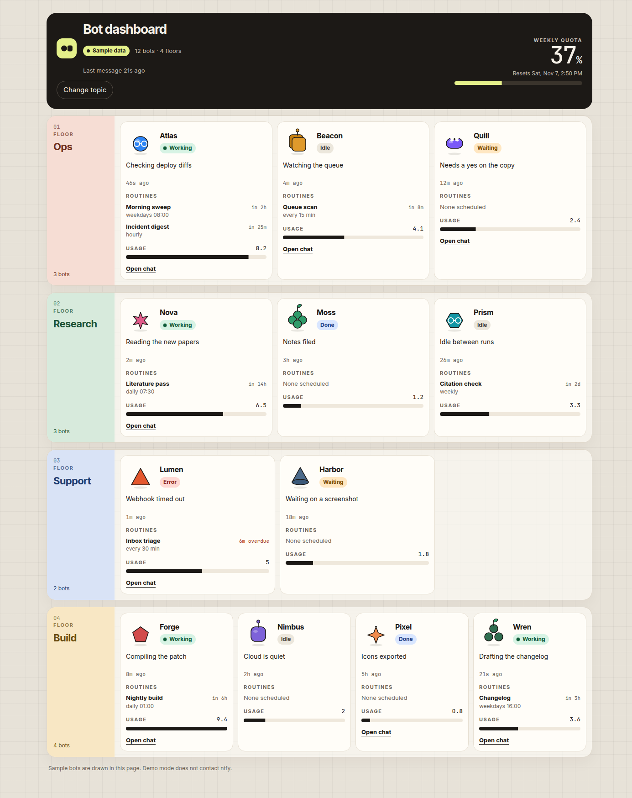

# bot-dashboard

A static status board for the owner's assistant bots. Each team is one floor. Each bot is a small avatar with its status, last step, routines, and share of usage. The page is plain HTML, CSS, and JavaScript, with no build step, so GitHub Pages can serve it from the repository root.



## Open the dashboard

After GitHub Pages is enabled, open:

[https://irons163.github.io/bot-dashboard/#](https://irons163.github.io/bot-dashboard/#)<topic>

Replace `<topic>` with the ntfy.sh topic the bots publish to. The page reads that name from the URL hash (`#…`), so the topic stays in the browser. It is not sent to GitHub and it is not stored in this repository.

To check the layout with fake bots and no network request, open:

[https://irons163.github.io/bot-dashboard/#demo](https://irons163.github.io/bot-dashboard/#demo)

`demo` is reserved for that sample view. If the hash is empty, the page shows a field where you can type a topic.

## The topic works like a password

ntfy.sh topics are public to anyone who knows the name. There is no separate login on this page. Anyone with the topic can read the same messages the dashboard shows, so share the full `#topic` link only with people who should see the bots. Do not commit the topic, paste it into issues, or leave it in a screenshot.

## Enable GitHub Pages

The files do not turn Pages on by themselves. On GitHub, in this repository:

1. Open **Settings → Pages**.
2. Under **Build and deployment**, set **Source** to **Deploy from a branch**.
3. Choose branch **main** and folder **/ (root)**, then save.

A minute or two later the site is at [https://irons163.github.io/bot-dashboard/](https://irons163.github.io/bot-dashboard/). A 404 on that address means Pages is still off, or the first deploy has not finished. This repository does not enable Pages automatically.

## What bots should publish

Each ntfy message body is one JSON object. The page loads the cached history (about 12 hours, which is how long ntfy keeps messages) from `https://ntfy.sh/<topic>/json?poll=1&since=12h`, then keeps the JSON stream open for live updates. Anything that is not valid JSON of the shapes below is ignored. A later message of the same kind replaces the earlier one; maps are merged per bot.

- Status: `{"bot":"Bot A","status":"working|idle|waiting_user|error|done","step":"short text"}`
- Routines: `{"routines":{"bot":"Bot A","items":[{"name":"Sweep","schedule":"weekdays 08:00","next_run":"ISO-8601"}]}}`
- Roster: `{"roster":["Bot A","Bot B"]}`
- Looks: `{"looks":{"Bot A":{"shape":"sphere|rounded_cube|pill|triangle|cone|pentagon|hexagon|star4|star6|clover|rounded_square|trio","color":"#2D84F5","accessory":"none|glasses|stem|antenna|bow"}}}`
- Groups: `{"groups":{"Bot A":"Ops"}}` — each group is one floor. Three to six teams fit the layout; other counts still render.
- Chat: `{"chat":{"Bot A":"grokbot://app/v1/agent?id=…"}}` — only `grokbot://` links become clickable.
- Usage: `{"type":"usage","total_used_pct":37,"resets_at":"ISO-8601","bots":{"Bot A":4.1}}`

Publish with the topic in an environment variable, not in the shell history of this repo:

```bash
curl -d '{"bot":"Bot A","status":"working","step":"Checking the queue"}' \
  "https://ntfy.sh/${TOPIC}"
```

Text from messages is rendered as text. The page does not use `innerHTML` for it.

## Local preview

From a local copy of the repository:

```bash
python3 -m http.server 8080
```

Open [http://127.0.0.1:8080/#demo](http://127.0.0.1:8080/#demo).
